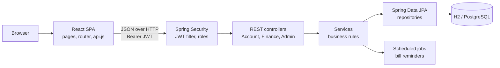

# FinTrack — Personal Finance Management System


FinTrack is a full-stack web application for managing personal finances: bills, income, spending, savings goals and budgets, all in one place. It pairs a **React** single-page app with a **Spring Boot REST API**, and was built with security in mind: hashed passwords, token-based authentication, role-based access control, account lockouts, and audit logging.

> Each member's financial records are private. No endpoint — including administrator endpoints — returns another user's finances.

---

## Highlights

- **Full-stack architecture:** React frontend talking to a layered Spring Boot backend (controller → service → repository) over a JSON REST API.
- **Stateless security:** JWT authentication, BCrypt password hashing, and three roles — **Owner**, **Administrator**, **Member** — enforced on the server.
- **Account protection:** 4 failed sign-ins trigger a 10-minute lockout, and a further failure locks the account until an administrator unlocks it. Every sign-in attempt is logged with IP address and browser.
- **Audit trail:** every profile change (edits, role changes, locks, unlocks, deletions) is recorded with who made it and the before and after values.
- **Bank statement import:** upload a CSV statement, review automatically suggested categories, then import the rows as costs and income.
- **Financial insight:** running balance, monthly spending limit based on a savings percentage, warnings when overspending, and a 30-day cash-flow projection.
- **Data integrity:** optimistic locking prevents duplicate bill payments from double clicks or concurrent requests, and every payment can be undone.
- **Tested:** 26 automated tests cover bill payment rules, the lockout flow, permissions, and user ID integrity.

---

## Features

### For members
| Area | What it does |
|---|---|
| **Dashboard** | Current balance (income received minus costs to date), this month's spending against your limit, and upcoming bills |
| **Bills** | Utilities, rent, loans, transportation and subscriptions with due dates and recurrence. Optional down payment. "Mark paid" once per billing period, with **Undo** |
| **Income** | One-off or recurring (weekly, bi-weekly, monthly, quarterly, yearly) with an optional end date |
| **Costs** | Spending by category: bills, groceries, transportation, entertainment, large purchases |
| **Savings** | Set a savings percentage. Going over the resulting monthly limit shows a warning and sends a notification |
| **Planner** | Try out purchases before making them: see the effect on your balance, your monthly limit and a 30-day projection. Nothing is saved |
| **Goals** | Saving plans with monthly amounts and top-ups. You're notified when a goal becomes affordable |
| **Search** | Query costs, income or totals by date range and category |
| **Statements** | CSV bank statement upload with a review step before import |
| **Notifications** | Reminders before bills are due and when they're overdue, from a daily scheduled job and on sign-in |
| **Profile** | Change your password and request profile changes for an administrator to review |

### For administrators and the owner
| Area | What it does |
|---|---|
| **User management** | Administrators edit, delete, lock and unlock members. The owner can also manage administrators and promote or demote them |
| **Change requests** | Approve or reject members' profile change requests with a note. The member is notified |
| **Sign-in log** | Every sign-in attempt with result, username entered, IP address and browser |
| **Profile change log** | Full audit trail of account changes with actor and before → after values |
| **Support requests** | Locked-out users can send a support request from the sign-in page. Admins can resolve it and unlock the account |

---

## Tech stack

| Layer | Technologies |
|---|---|
| **Frontend** | React 18, React Router 6, Vite 5, JavaScript, CSS |
| **Backend** | Java 21, Spring Boot 3.5, Spring Web, Spring Data JPA (Hibernate), Bean Validation |
| **Security** | Spring Security, OAuth2 Resource Server (JWT, HS256), BCrypt |
| **Database** | H2 (file-based, for development), PostgreSQL (production profile) |
| **Testing** | JUnit 5, Spring Boot Test, Spring Security Test, AssertJ |
| **Build** | Maven (wrapper included), npm |

---

## Architecture



**How a request flows:** the React app calls an endpoint such as `GET /api/bills` with the user's token. Spring Security checks the token and the user's role. The controller passes the request to a service, which applies the business rules and loads data through a repository scoped to the signed-in user. The response goes back as JSON.

```
fintrack/
├── backend/                     Spring Boot API
│   └── src/main/java/com/fintrack/
│       ├── model/               JPA entities (User, Bill, Income, Expense, Goal, AuditLog, ...)
│       ├── repository/          Spring Data JPA repositories
│       ├── security/            Security config, JWT service, current-user lookup, owner setup
│       ├── service/             Business logic (bills, finance totals, accounts, admin, statements)
│       └── web/                 REST controllers, DTOs, error handling
└── frontend/                    React app
    └── src/
        ├── pages/               Dashboard, Bills, Income, Costs, Goals, Planner, Admin, ...
        ├── components/          Shared layout
        ├── api.js               API client
        └── auth.jsx             Sign-in state and protected routes
```

---

## Engineering decisions

- **Privacy enforced in the data layer.** Repository lookups use the signed-in user's ID, for example `findByIdAndUserId`. Asking for another user's record returns `404`, which doesn't even reveal that the record exists.
- **Locks take effect immediately.** JWTs are stateless, so a locked user could otherwise keep using an existing token. Every request checks the account's current status, which ends open sessions as soon as an account is locked.
- **Lockout without log flooding.** Attempts on an already-locked account are refused before the password is checked and aren't logged, so repeated attempts can't fill the sign-in log. Support requests are limited to 3 per IP address per hour.
- **Payment rules on the server.** Bills can be marked paid only once per billing period and never more than one period ahead. The browser blocks double clicks, and a `@Version` optimistic lock on the server rejects concurrent duplicates.
- **Aggregates in the database.** Totals are computed with JPQL `SUM` queries instead of loading every row into Java.
- **Exact money handling.** Amounts use `BigDecimal` and are stored as `DECIMAL(14,2)` to avoid floating-point rounding errors.
- **Database-portable.** The same code runs on H2 or PostgreSQL by switching a Spring profile.
- **Consistent errors.** A global exception handler returns JSON errors with clear status codes and messages.

---

## Getting started

**Requirements:** Java 21+ and Node 18+. Maven isn't needed, because the backend includes the Maven wrapper.

**1. Start the backend** (http://localhost:8080)

```bash
cd backend
./mvnw spring-boot:run        # Windows: mvnw.cmd spring-boot:run
```

**2. Start the frontend** (http://localhost:5173, forwards `/api` to the backend)

```bash
cd frontend
npm install
npm run dev
```

**3. Sign in.** On first start, the backend creates the **Owner** account with username `owner` and password `ChangeMe123!`. Change it from the Profile page, or set `OWNER_USERNAME`, `OWNER_EMAIL` and `OWNER_PASSWORD` before the first start. Register new accounts from the home page to try the Member role.

**Run the tests**

```bash
cd backend
./mvnw test
```

Data is stored in an H2 file database in `backend/data/`. Delete that folder to start over.

<details>
<summary><strong>Configuration</strong></summary>

| Setting | Where | Default |
|---|---|---|
| JWT signing secret | `JWT_SECRET` environment variable (32+ characters) | A development-only value. **Set this outside local development** |
| Owner account | `OWNER_USERNAME`, `OWNER_EMAIL`, `OWNER_PASSWORD` | `owner` / `ChangeMe123!` |
| Sign-in lockout | `app.security.max-login-attempts`, `app.security.lockout-minutes` | 4 attempts, 10 minutes |
| Bill reminder window | `app.notifications.bill-due-days` | 3 days |
| Daily reminder check | `app.notifications.cron` | 08:00 every day |
| PostgreSQL | Run with `--spring.profiles.active=postgres` and set `DB_URL`, `DB_USERNAME`, `DB_PASSWORD` | H2 file database |

**Single deployable:** run `npm run build` in `frontend`, copy `frontend/dist/*` into `backend/src/main/resources/static/`, then run `./mvnw package`. The jar in `backend/target/` serves both the app and the API.

</details>

<details>
<summary><strong>REST API overview</strong></summary>

All endpoints are under `/api` and require `Authorization: Bearer <token>`, except `auth/*`.

```
POST auth/register, auth/login, auth/support
GET  me              PUT me/savings, me/password
GET/POST me/change-requests
GET/POST bills       PUT/DELETE bills/{id}     POST bills/{id}/pay, bills/{id}/undo-payment
GET/POST incomes     PUT/DELETE incomes/{id}
GET/POST expenses    PUT/DELETE expenses/{id}
GET/POST goals       PUT/DELETE goals/{id}     POST goals/{id}/contribute
GET  dashboard       POST planning             GET query?type=COST|INCOME|TOTAL&from&to&category
GET  statements      POST statements/preview (multipart), statements/import
GET  notifications   POST notifications/{id}/read, notifications/read-all   DELETE notifications/{id}
Admin/Owner:  GET admin/users  PUT/DELETE admin/users/{id}  POST admin/users/{id}/lock, admin/users/{id}/unlock
              GET admin/audit-log?username=   GET admin/login-attempts?username=&outcome=
              GET admin/support-requests?status=  POST admin/support-requests/{id}/resolve
              GET admin/change-requests?status=  POST admin/change-requests/{id}/approve|reject
Owner:        PUT owner/users/{id}/role
```

</details>

---

## Author

**William McKenzie** — [GitHub](https://github.com/WilliamMcKenzieJr)
